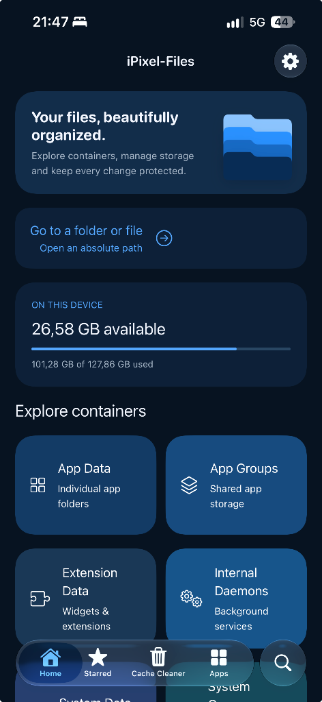
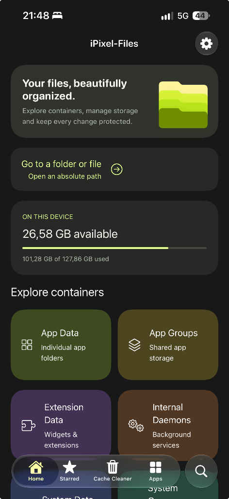

# iPixel-Files

<p align="center">
  
</p>

<p align="center">
  A native iOS container browser, app manager, and file manager for iOS 26 and iOS 27.<br>
  Built on the <code>worse_query</code> sandbox technique without jailbreak or kernel exploits.
</p>

<p align="center">
  
  &nbsp;&nbsp;
  
</p>

iPixel-Files is a redesigned and extended native client based on [WQFiles](https://github.com/kolbicz/WQFiles) by [kolbicz](https://github.com/kolbicz). It provides direct access to installed application containers, app groups, extension containers, and daemons on iOS 26 and iOS 27 without a jailbreak.

Version 2.1 introduces full Arabic/RTL localization, an in-app Settings panel, customizable tab bar navigation, LaunchServices-first container discovery, and selectable alternate app icons.

## Features

- **Appearance and Themes**: Choose between iPixel Blue and iPixel Lime styles with automatic Light/Dark/System appearance matching.
- **Selectable App Icons**: Pick from 9 alternate colorways (Blue, Lime, Purple, Pink, Red, Orange, Gold, Teal, Monochrome) or let the app follow the active theme.
- **Customizable Navigation**: Add, remove, or reorder tabs in Settings (Home, Apps, Starred, Recents, Cache Cleaner, Go to Path, App Backups, Dual Browser, and Log). Supports the native system search tab on compact layouts.
- **Arabic and RTL Support**: Native Right-to-Left layout with Arabic translations (`ar.lproj`) and right-edge back gesture navigation. File paths and bundle identifiers remain LTR.
- **Container Browsing**:
  - **App Data**: Inspect installed app containers (`Containers/Data/Application`) with resolved app names and icons instead of raw UUIDs.
  - **App Groups**: Shared group containers.
  - **Extension Data & Internal Daemons**: Background services and extension storage.
  - **System Data & System Groups**: Access system container roots where supported (e.g. MobileGestalt cache, supervision profiles).
  - **Go to Path**: Navigate directly to any absolute path.
- **Dual Browser**: Two-pane browser on iPad; retained Left/Right location on iPhone with parent folder navigation.
- **View Modes and Sorting**: List and two-column grid views with image/video thumbnails; sort by name, date, size, or file extension.
- **Batch Actions**: Multi-select files to share, copy between directories, or delete with verified backups.
- **App Management**:
  - View apps with disk usage and authentic icons via LaunchServices.
  - Quick action to copy bundle IDs.
  - Back up Documents and Library containers to ZIP archives.
  - Restore backups or wipe cache/tmp directories.
- **Cache Cleaner**: Per-app cache and temporary storage breakdown, large cache filters (50 MB+), and crash log cleanup.
- **Built-in Editors**:
  - Property list editor (XML and binary plists) with in-place value editing.
  - Paged hex viewer and editor with byte searching and in-place patching.
  - Text editor and image viewer.
- **Media and Archives**:
  - Audio and video players with swipe-down dismissal.
  - ZIP and TAR archive extraction.
  - Read-only SQLite viewer with automatic WAL/SHM sidecar redirection.

## Safety Measures

To prevent accidental file loss when editing container data:

1. **Pre-operation Backups**: Overwritten or deleted regular files are copied to the internal `Backups` directory first (accessible in the Files app). Backups can be restored to their original location at any time.
2. **Transactional Verification**: App backups and restores verify source stability digests, destination shape digests, and content part hashes before and after operations.
3. **Restricted Deletion**: Only empty directories can be deleted in the browser; symbolic links are removed as links without touching targets.
4. **Advisory File Locking**: Protects files from concurrent modification where supported.

## Installation

Download the latest `iPixel-Files.ipa` from [Releases](https://github.com/ipixeldev/iPixel-Files/releases).

### Sideloading and the App Group Entitlement

The `worse_query` technique relies on an **App Group** to negotiate sandbox tokens. The IPA must be signed with an App Group entitlement (`group.app.ipixel.files` or any group provisioned by your signer).

- **AltStore / SideStore**: Automatically creates and injects an App Group during installation.
- **Sideloadly**: Automatically handles App Group provisioning with free or paid Apple IDs.
- **TrollStore** (iOS 15.0 – 17.0): Direct installation with all entitlements preserved.
- **Developer Certificate**: In the Apple Developer portal, create an App Group, assign it to an explicit App ID with the App Groups capability enabled, and sign with that profile.

## Building

### Requirements
- macOS with Xcode or Command Line Tools
- Python 3

### Build Script

To run the regression suite, compile the arm64 binary, and package the signed IPA:

```bash
./build.sh
```

To specify an output path:

```bash
WQFILES_FINAL_IPA="$PWD/iPixel-Files.ipa" ./build.sh
```

### GitHub Actions

A workflow is provided under `.github/workflows/build-ipixel.yml` to compile the IPA on a hosted macOS runner:
1. Push to your repository.
2. Go to **Actions -> Build iPixel-Files IPA -> Run workflow**.
3. Download the `iPixel-Files-IPA` artifact from the summary page.

## Testing

Run the regression test suite:

```bash
./tests/run_all_tests.sh
```

Pass `WQ_SKIP_IOS_CHECK=1` to run host tests without an iOS SDK, or `WQ_ASAN=1` to enable AddressSanitizer on host binaries.

## Troubleshooting

- **Apps list is empty**: The app queries LaunchServices first and falls back to an inode scan (`fsgetpath`). If an inode scan is needed, the initial pass may take a minute. Check the in-app Log for `enumerate:` or `app scan:` entries.
- **NO TOKEN**: `wq_grant` could not acquire a sandbox token. Verify that your sideloading tool signed the app with an active App Group entitlement.
- **(no label)**: The container token was granted, but the container identifier xattr or metadata plist was unreadable. The directory remains browsable, but backup and clear options are disabled until identity can be verified.

## Credits

- **iPixel-Files**: [iPixelDev](https://github.com/ipixeldev)
- **WQFiles**: [kolbicz](https://github.com/kolbicz)
- **worse_query**: [Taj C (forcequit)](https://github.com/forcequitOS/worse_query)
- **KAMUI inode scan**: [murk-sus](https://github.com/murk-sus/kamui-escape)
- **Typography**: Press Start 2P by CodeMan38 (SIL Open Font License 1.1)

Licensed under the GNU General Public License v3.0 or later. See [LICENSE](LICENSE).
